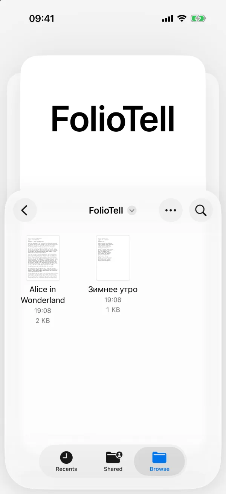
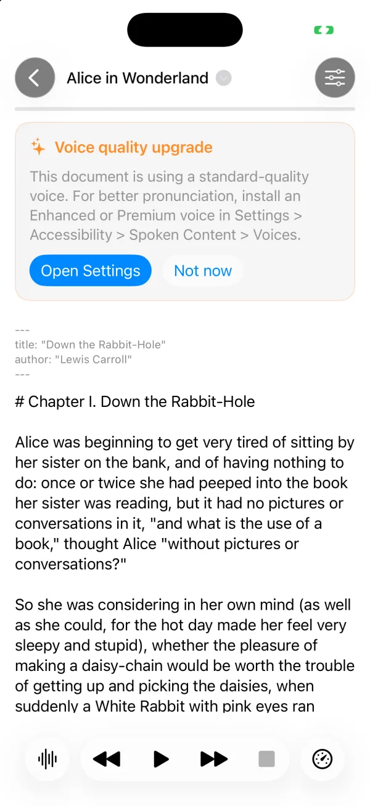
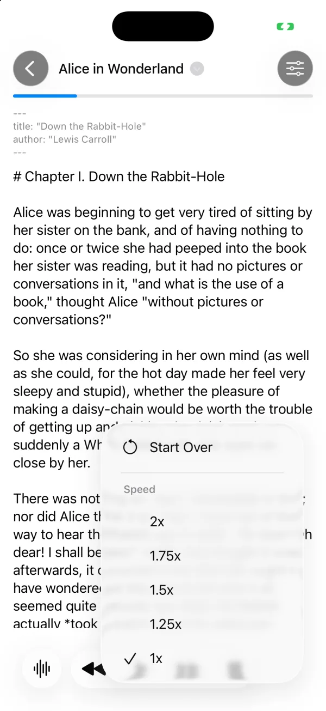

# FolioTell

An iPhone app that reads your Markdown and plain-text files aloud. Open a
file from the system document browser, press Play, and listen. FolioTell works
offline and is read-only: no account, no backend, no analytics, no
subscription and no network.

| | |
|---|---|
|  |  |

## What it does

- **Opens your files where they are**: `.md` and `.txt` from On My iPhone,
  iCloud Drive or any Files provider, through the system document browser.
- **Reads them with Apple's speech synthesis**, on the device. The voice
  follows the document's language (English or Russian), or you pick one.
- **Playback controls**: play and pause, the previous or next sentence, stop,
  start over, and speeds from 1x to 2x.
- **Remembers where you stopped** in each document.
- **Front matter**: a YAML header at the top of a Markdown file is skipped,
  or read aloud if you choose.
- **Suggests a better voice**: when only a standard-quality voice is
  installed for the document's language, it says where in Settings to
  download an Enhanced or Premium one.

| | | |
|---|---|---|
|  |  |  |

## How it is built

- Swift 6 and SwiftUI, iOS 26. A `DocumentGroup` app over
  `AVSpeechSynthesizer`.
- The playback logic is a separate library, `FolioTellCore`: pure reducers
  and effect handlers for playback and the remembered position, with the
  speech engine and storage behind injected adapters.
- 196 Swift Testing tests in 20 suites, run with `swift test`.
- Maestro flows in [`ios/.maestro/flows/`](ios/.maestro/flows/) drive the
  playback controls on a simulator.
- Built with AI coding agents working from specs and tests.

## Running it

```sh
cd ios
swift build
swift test
```

Open `ios/FolioTell.xcodeproj` in Xcode 26 to run the app on a simulator or
device. Signing uses the developer's team; set your own to run it on a device.

## About this repository

This is a published snapshot of a project developed in a private monorepo.
Issues are welcome; pull requests may not be merged here.

## License

[MIT](LICENSE)
